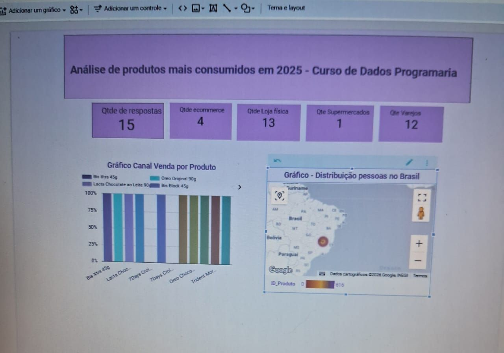

# Projeto de Dashboard em Power BI

## Sobre o projeto
Projeto de visualização de dados desenvolvido utilizando o Microsoft Power BI, com foco na apresentação de informações por meio de um dashboard.

## Ferramenta utilizada
- Microsoft Power BI

## Visualização do dashboard

## Objetivo
Apresentar informações de maneira visual e organizada, facilitando a interpretação dos dados.

## Portfólio
Este projeto faz parte do meu portfólio de estudos e desenvolvimento de habilidades em tecnologia e Business Intelligence.
